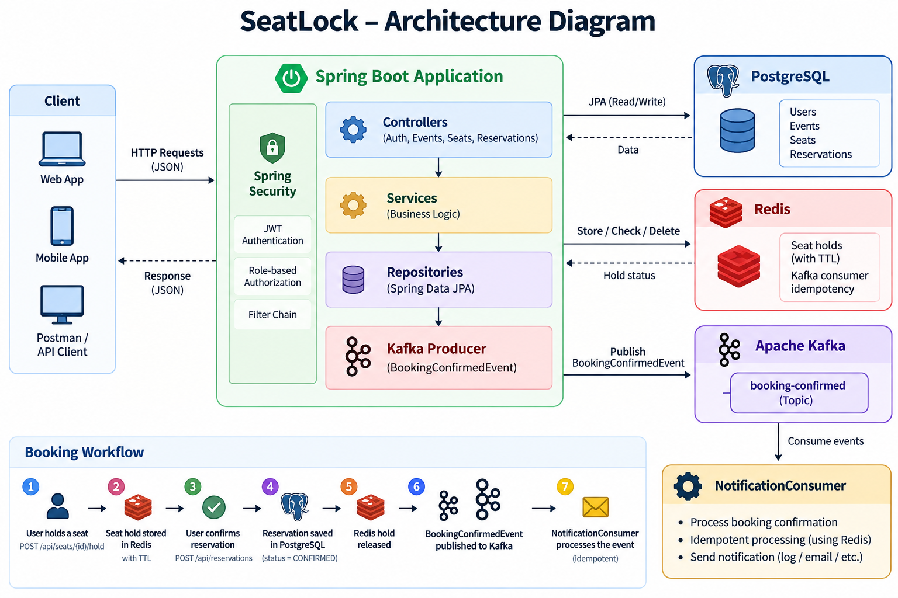

# SeatLock

SeatLock is a backend system for secure and concurrent event seat booking built with Spring Boot.

The project focuses on preventing double booking, managing temporary seat holds with Redis, securing APIs with JWT, and publishing booking events asynchronously through Kafka.

## Features

- User registration and login with JWT authentication
- Role-based authorization with `USER` and `ADMIN`
- Event and seat management
- Temporary seat holds using Redis with automatic expiration
- Double-booking prevention
- Transactional reservation workflow
- Asynchronous `BookingConfirmed` events using Kafka
- Notification consumer
- Idempotent Kafka event processing using Redis

## Tech Stack

- Java 21
- Spring Boot
- Spring Security
- JWT
- Spring Data JPA
- PostgreSQL
- Redis
- Apache Kafka
- Docker & Docker Compose
- JUnit 5
- Mockito
- Maven

## Architecture

```text
Client
  |
  v
Spring Security / JWT
  |
  v
Spring Boot
  |
  +---- PostgreSQL
  |       Users
  |       Events
  |       Seats
  |       Reservations
  |
  +---- Redis
  |       Temporary seat holds
  |       Kafka consumer idempotency
  |
  +---- Kafka
          booking-confirmed topic
                  |
                  v
          NotificationConsumer
```


## Booking Workflow

```text
User
  |
  v
Hold Seat
  |
  v
Redis stores temporary hold
  |
  v
Confirm Reservation
  |
  v
Reservation saved in PostgreSQL
  |
  v
Redis hold released
  |
  v
BookingConfirmed event published
  |
  v
Kafka
  |
  v
NotificationConsumer
```

When a user wants to reserve a seat, the seat is first temporarily locked in Redis.

The hold expires automatically after a short TTL if the reservation is not completed.

When the reservation is confirmed:

1. The reservation is stored in PostgreSQL.
2. The Redis seat hold is released.
3. A `BookingConfirmedEvent` is published to Kafka.
4. The `NotificationConsumer` consumes the event.
5. Redis is used to prevent duplicate processing of the same booking event.

## Running the Project

### Prerequisites

Make sure the following tools are installed:

- Java 21
- Docker Desktop
- Maven, or use the included Maven Wrapper

### 1. Configure environment variables

Create a `.env` file at the root of the project:

```env
POSTGRES_PASSWORD=your_postgres_password
```

Do not commit the `.env` file to Git.

### 2. Start the infrastructure

From the project root, run:

```bash
docker compose up -d
```

Docker Compose starts:

- PostgreSQL
- Redis
- Kafka

You can verify the containers with:

```bash
docker compose ps
```

### 3. Start the Spring Boot application

On Windows:

```powershell
.\mvnw.cmd spring-boot:run
```

On Linux or macOS:

```bash
./mvnw spring-boot:run
```

The application runs on:

```text
http://localhost:8080
```

## Main API Endpoints

| Method | Endpoint | Description |
|---|---|---|
| POST | `/api/auth/register` | Register a new user |
| POST | `/api/auth/login` | Login and receive a JWT |
| GET | `/api/events` | List events |
| POST | `/api/events` | Create an event - ADMIN |
| GET | `/api/events/{eventId}/seats` | List seats of an event |
| POST | `/api/events/{eventId}/seats` | Create a seat - ADMIN |
| POST | `/api/seats/{seatId}/hold` | Temporarily hold a seat |
| POST | `/api/reservations` | Confirm a reservation |

Protected endpoints require a JWT:

```text
Authorization: Bearer <token>
```

## Example Reservation Flow

### 1. Login

```http
POST /api/auth/login
```

```json
{
  "email": "alice@example.com",
  "password": "secret123"
}
```

The response contains a JWT token.

### 2. Hold a seat

```http
POST /api/seats/{seatId}/hold
```

Header:

```text
Authorization: Bearer <token>
```

No request body is required.

### 3. Confirm the reservation

```http
POST /api/reservations
```

Header:

```text
Authorization: Bearer <token>
```

Body:

```json
{
  "seatId": 5
}
```

A successful reservation is stored with status:

```text
CONFIRMED
```

A `BookingConfirmedEvent` is then published to Kafka.

## Testing

Run the tests with:

```bash
./mvnw test
```

On Windows:

```powershell
.\mvnw.cmd test
```

The project includes unit tests using JUnit 5 and Mockito for important booking scenarios such as:

- Successful reservation
- Reservation without a valid Redis hold
- Attempting to reserve an already booked seat
- Verification that Kafka events are published after successful bookings

## Key Design Decisions

- **PostgreSQL** is the source of truth for users, events, seats, and reservations.
- **Redis** provides atomic temporary seat holds to reduce concurrent booking conflicts.
- **Redis TTL** automatically releases abandoned seat holds.
- **Kafka** decouples booking confirmation from notification processing.
- **Redis-based idempotency** prevents the Kafka consumer from processing the same booking event multiple times.
- **JWT** provides stateless authentication.
- **Spring Security** handles authentication and role-based authorization.
- **Docker Compose** provides a reproducible local environment for PostgreSQL, Redis, and Kafka.